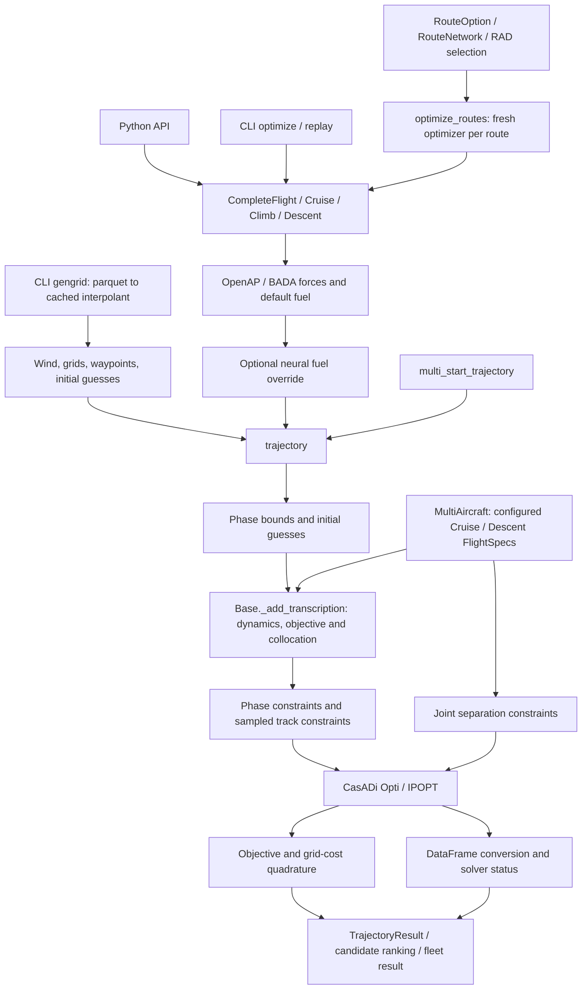

# OpenTOP execution flow

Current working-tree architecture, reviewed 2026-09-25. See the
[API guide](api-guide.md) for units, options and limitations.

## Construction and transcription

The public API is exported from `opentop/__init__.py`. Base initialization
resolves endpoints, selects performance models, sets mass bounds, and configures
solver defaults. `fuel_model` replaces fuel flow while retaining baseline forces
and OpenAP aircraft limits. Neural overrides require still air. Physical
correction models have their own checked aircraft/engine configuration; `engine=`
on the optimizer does not rebuild those models or recalibrate Acropole.

Phase `init_conditions()` methods establish state/control bounds and guesses.
Climb and descent can first solve a preliminary cruise, with the same fuel
selection, to obtain boundary context. `_build_opti()` is the standalone
wrapper around the reusable `_add_transcription()` scaffold. Cruise and descent
also expose reusable formulations for joint fleet problems.

The scaffold creates state/control variables, final time, Legendre collocation
equations, continuity and objective quadrature. Controls interpolate linearly;
phase-specific constraints follow. Cruise can choose a constant Mach, pin a
specified `mach_value`, or follow a recorded spline track with sampled tolerance
checks. These options are distinct from constant-heading constraints.

## Solving and reporting

`Base._solve()` configures IPOPT and stores its status, objective value and grid
quadrature. `_trajectory.to_dataframe()` reports numeric states and controls,
mass-derived fuel costs and instantaneous fuel flow. The resolved numeric fuel
model is shared with numeric objectives and emissions. `TrajectoryResult` uses
solver grid quadrature when available; summing the DataFrame grid-cost column
is a different, node-based approximation.

Multi-start wraps repeated solves and ranks successful candidates ahead of failed
ones, then by objective. Optional Mach jitter supplements lateral and altitude
perturbations. It is not post-processing and does not certify global optimality.
See [candidate accounting](design/multi_start_trajectory.md).

`optimize_routes()` solves independent route options and selects by fuel or the
configured objective. `MultiAircraft` instead constructs a joint NLP for cruise
or descent aircraft and verifies sampled separation with refinement. These are
different workflows; route-choice search does not provide fleet separation.

## CLI and optional inputs

`opentop optimize` parses weighted objectives and uses the same phase classes.
`opentop gengrid` filters/pads parquet grids and saves cached CasADi interpolants.
Grid objectives support 3D spatial and 4D time-dependent inputs; spline costs
require appropriate exact-Hessian handling.

`opentop replay` loads or fetches a flight, infers aircraft/endpoints, optionally
retrieves ERA5 weather and constructs contrail costs, then saves observed and
optimized trajectories. `enable_wind()` fits a `PolyWind` field for dynamics;
it rejects neural fuel overrides. Fleet wind and time-dependent grid objectives
remain unsupported. The CLI does not currently expose neural fuel configuration.
